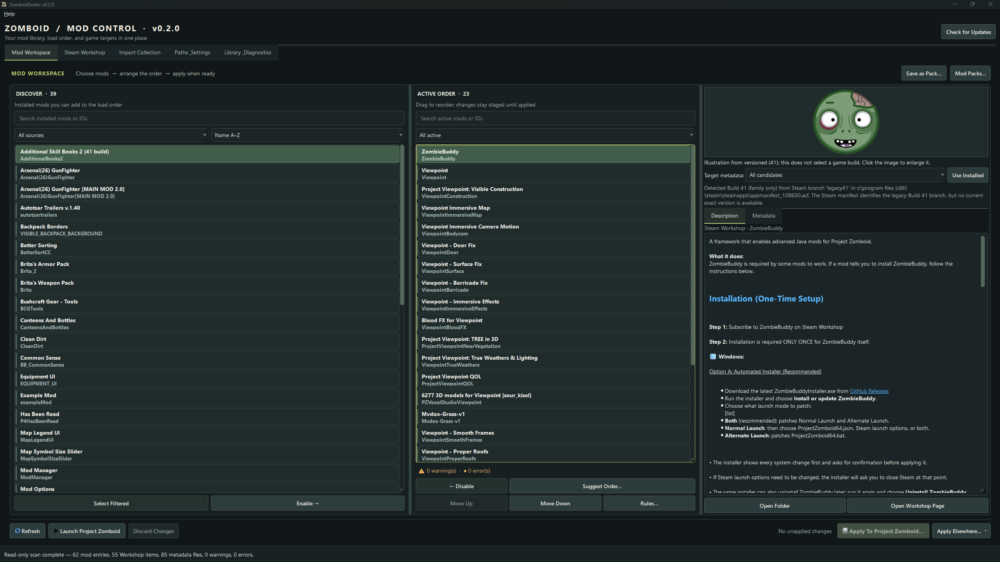
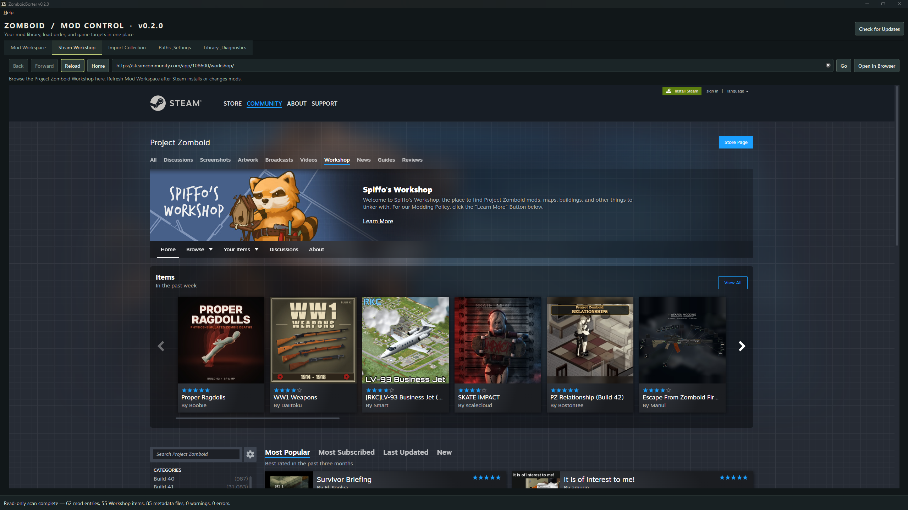
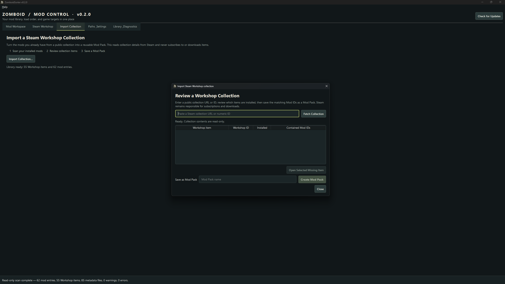
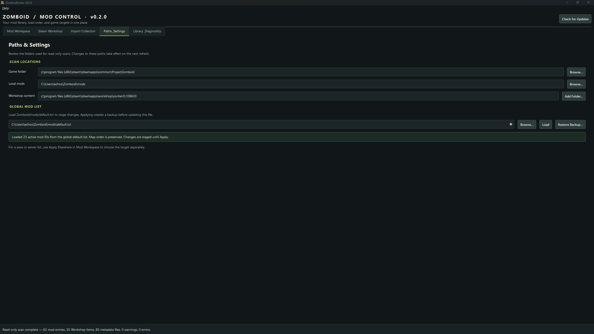

<div align="center">


**Make sense of your Project Zomboid mod list.**

[Download for Windows](https://github.com/LookImEcho-Rick/ZomboidSorter/releases) · [Quick start](#quick-start) · [View screenshots](#see-it-in-action)

</div>

ZomboidSorter brings local and Steam Workshop mods into one workspace. Inspect what is installed, arrange a load order, save it as a Mod Pack, and choose exactly where to apply it. Built for people who want a clearer view of a growing mod library without editing game files by hand.

## What you can do

- **Find and understand your mods.** Search by name or ID, preview descriptions and metadata, and spot missing or duplicate Mod IDs.
- **Build an order before changing the game.** Enable, disable, drag, and reorder mods in a staged list. Dependency suggestions show a proposed order you can review.
- **Keep loadouts ready.** Save Mod Packs, preview their changes against the loaded global list, import a save's mod list, and turn installed items from a public Workshop collection into a pack.
- **Choose the target.** Apply to the global list, one save, or one server configuration through separate confirmed actions with backups and validation.
- **Investigate issues.** Inspect declared dependencies, potential file overlaps, and selected console-log findings on demand.

A Workshop item may contain several mods. ZomboidSorter tracks each Mod ID separately from its Workshop ID.

## See it in action

Screenshots from v0.2.0 show the workspace with an installed mod library. The settings view includes local folder paths from the captured machine.



<details>
<summary>View Steam Workshop, collection import, and settings</summary>

**Steam Workshop**



**Import a Workshop collection**



**Paths & Settings**



</details>

## Quick start

1. Download **`ZomboidSorter-windows-setup.exe`** from the [latest stable release](https://github.com/LookImEcho-Rick/ZomboidSorter/releases). The installer includes Python and Qt; a separate Python installation is not needed.
2. Launch Project Zomboid through Steam at least once. If `Zomboid/mods/default.txt` does not exist yet, open the game's Mods screen so it can create the global list.
3. Open **Paths & Settings** to confirm your game, local-mod, Workshop, and global-list paths. Select **Refresh** in Mod Workspace to scan. Scanning only reads installed folders.
4. In **Mod Workspace**, move mods from **Discover** to **Active Order** and arrange them. Select a mod to read its **Description** or **Metadata**. Nothing is written to the game while you stage changes.
5. Save the order as a **Mod Pack** if you want to reuse it. When ready, use the primary **Apply** action for the global list, or **Other Targets… / Apply Elsewhere…** for one save or server.

**Use Installed** in the details pane selects the detected Build 41 or 42 metadata family. An exact Build 42 version can select an appropriate versioned `mod.info` candidate. This helps display metadata and suggest an order; it does not prove that a mod's content works in that game build.

## Know what each action changes

| Action | Result |
| --- | --- |
| Scan, search, reorder, and Suggest Order | Reads installed mods and stages an in-memory list. Suggestions use declared constraints and are not a guarantee of runtime load order. |
| Save or import a Mod Pack | Writes an app-owned pack. Importing from a save or public Workshop collection does not change the save or subscribe to Workshop items. |
| Apply to Project Zomboid | Previews ordered Mod ID and map changes, then updates only the global `Zomboid/mods/default.txt` after confirmation, backup, concurrent-change check, atomic replacement, and readback validation. |
| Apply to a save | Previews the ordered Mod ID changes, then updates one selected immediate save's `mods.txt`; existing maps are preserved. |
| Apply to server settings | Previews Mod ID and Workshop ID changes, then updates only `Mods` and `WorkshopItems` in one selected server `.ini`; other settings remain in place. |
| Restore a save/server backup | Choose a timestamped backup for the selected target, preview its Mod ID/map or server-list changes, and confirm before restoring. The current file is backed up first when it exists. |
| Reset a save to the global list | Preview and back up its explicit `mods.txt`, then remove that file so the save inherits the global default list again. |

Existing save and server files are also backed up before a write. Stop the game or server and close its settings editor before applying. **Apply & Launch…** applies staged global changes first, then asks Steam to launch the game; a successful handoff does not confirm that the game opened.

## Compatibility and limits

| Target | Current evidence |
| --- | --- |
| Windows 11, 64-bit | Verified development target; packaged launch and installer smoke checks run locally and on hosted Windows Server 2022. |
| Windows 10 | Not a verified support target. [Windows 10 Home and Pro support ended in 2025](https://learn.microsoft.com/en-us/lifecycle/products/windows-10-home-and-pro). |
| Project Zomboid Build 42 | Build 42.21.0 metadata selection and disposable configuration flows were checked. Gameplay and full loader behavior remain unverified. |
| Project Zomboid Build 41 | The installed `legacy41` branch and Build 41 metadata selection were checked. Disposable global-list flows passed; gameplay remains unverified. |

Discovery skips links and junctions, limits each `mod.info` read to 1 MiB, and reports unreadable or invalid metadata. Sorting, overlap, and console findings are evidence to review, not claims of an in-game conflict. See [validation history](docs/PROGRESS.md) for the exact checks and limitations.

## Updates and download verification

The **Check for Updates** button looks for a Windows installer published after GitHub's build and smoke checks pass. It verifies the package build ID, size, and SHA-256 before handing off to the installer, then reports the result after relaunch. It never applies raw source commits. Stable and rolling channels both use the versionless filename `ZomboidSorter-windows-setup.exe`.

The installer is **unsigned**, so Windows SmartScreen may show **Unknown publisher**. Download only from the [official Releases page](https://github.com/LookImEcho-Rick/ZomboidSorter/releases), compare the adjacent `.sha256` file with `Get-FileHash .\ZomboidSorter-windows-setup.exe -Algorithm SHA256`, and proceed only if they match. On the SmartScreen dialog, **More info → Run anyway** may be available. If the filename or checksum differs, choose **Don't run**. [Why SmartScreen warns](https://learn.microsoft.com/en-us/windows/apps/package-and-deploy/smartscreen-reputation).

<details>
<summary>See an example SmartScreen dialog and verify GitHub build provenance</summary>


The example is from v0.1.0; the current version appears in the app and installer metadata. For releases with an artifact attestation, run this in the download folder:

```powershell
$installer = Get-Item .\ZomboidSorter-windows-setup.exe
gh attestation verify $installer.FullName --repo LookImEcho-Rick/ZomboidSorter --signer-workflow LookImEcho-Rick/ZomboidSorter/.github/workflows/release-windows.yml
```

The attestation ties the exact installer to the repository workflow. It does not sign the installer or suppress SmartScreen.

</details>

## Your data and backups

Standard installs keep Mod Packs under `%APPDATA%\ProjectZomboidModManager\profiles\` and settings in the current user's Qt registry key. Portable installs keep both in `data\` beside the app; choose **Portable installation** during setup and use a writable folder.

Global-list backups sit beside `default.txt` as `default.txt.bak-<timestamp>`. **Restore Backup…** in Paths & Settings can preview and restore one. Save and server backups sit beside the file they protect; use **Apply Elsewhere…** to restore a save/server backup, or reset an explicit save list to global inheritance. Server restore previews changed settings and masks secret-like values. The app remembers the last save and server folders. Replaced or deleted Mod Packs have recoverable copies in the pack store.

Upgrades and uninstall leave app data, game-list backups, saves, and installed mods in place. Switching between standard and portable modes does not move data; export and import Mod Packs to transfer them. See [packaging details](packaging/README.md) for install modes and release checks.

## Troubleshooting

- **No mods found:** check Paths & Settings and whether Steam has installed the Workshop content. One Workshop item can provide multiple Mod IDs.
- **Cannot apply:** load the global `Zomboid/mods/default.txt` or choose the separate save/server target. The app refuses unknown syntax, links, unsafe targets, and files changed since loading.
- **Workshop page or description unavailable:** check Steam or network access; local metadata remains usable.
- **Launch did not start the game:** open it from Steam directly. The app can confirm only that Windows accepted the Steam link.
- **Need diagnostic help:** choose **Help → Save Support Report…**. Review its preview before saving; it omits paths, names and IDs, logs, and file contents.
- **Need to roll back:** use **Restore Backup…** for the global list, or use the save/server restore actions under **Apply Elsewhere…**. Each restore previews the change and creates a fresh backup of an existing current file. To make a save inherit global settings again, choose **Reset save to inherit global list…**.

## Run from source

Use Python 3.14+ on Windows:

```powershell
python -m venv .venv
.\.venv\Scripts\python.exe -m pip install -e ".[dev,windows]" -c packaging\constraints-windows.txt
.\.venv\Scripts\python.exe -m zomboid_mod_manager
```

For tests, lint, and installer instructions, see [packaging/README.md](packaging/README.md). The original code is [GPL-3.0-or-later](LICENSE); bundled components have their own terms. ZomboidSorter is an independent fan tool and is not affiliated with The Indie Stone.

**Development note:** AI tools assisted with portions of the code and documentation. Maintainers remain responsible for review and release validation.
