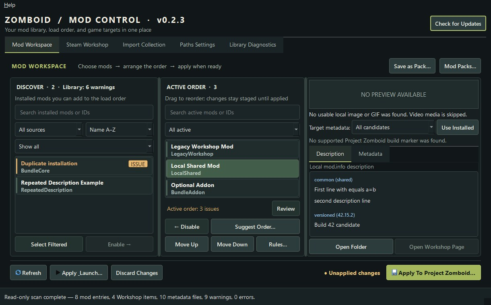
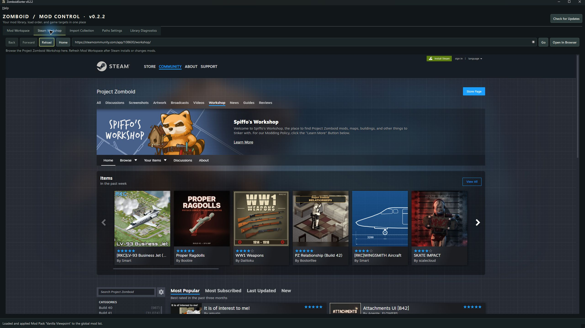
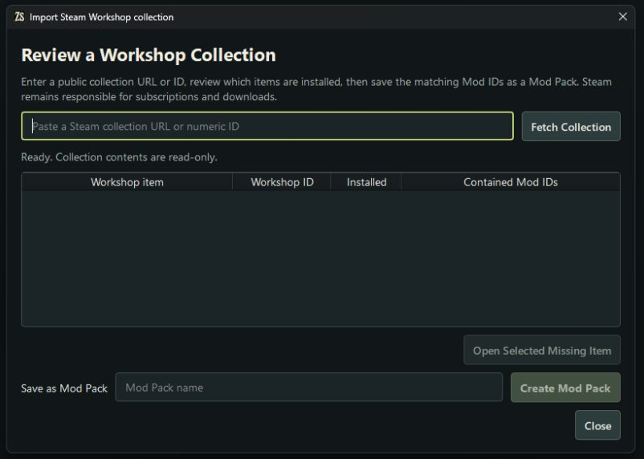
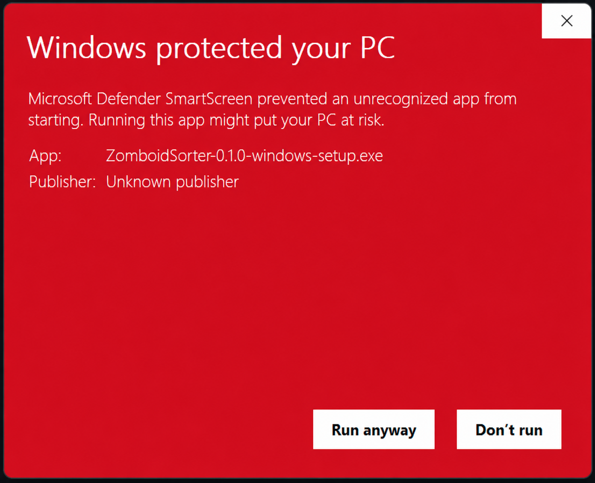

<div align="center">


**Make sense of your Project Zomboid mod list.**

[Download for Windows](https://github.com/LookImEcho-Rick/ZomboidSorter/releases) · [Quick start](#quick-start) · [View screenshots](#see-it-in-action)

</div>

ZomboidSorter brings local and Steam Workshop mods into one workspace. Inspect what is installed, arrange a load order, save it as a Mod Pack, and apply it to the game's global mod list. Built for people who want a clearer view of a growing mod library without editing game files by hand.

## What you can do

- **Find and understand your mods.** Search by name or ID, preview descriptions and metadata, and spot missing or duplicate Mod IDs.
- **Build an order before changing the game.** Enable, disable, drag, and reorder mods in a staged list. Dependency suggestions show a proposed order you can review.
- **Keep loadouts ready.** A fresh install includes an empty **Default** Mod Pack, which you can overwrite through **Save as Pack**. Save other packs, preview their changes against the loaded global list, and browse public Workshop collections by search, popularity, rating, date, and build tag. Save a collection's mods together as one named Mod Pack without changing Steam subscriptions. If multiple Workshop items provide the same Mod ID, choose which item to keep before saving; load the pack when ready. Group existing saves under one pack and view them from the workspace; this changes only ZomboidSorter's app data.
- **Update the game list safely.** Check for missing or duplicate active Mod IDs and declared dependency issues before applying or launching, then update only the global `Zomboid/mods/default.txt` list through a confirmed action with backup and validation.
- **Investigate issues.** Inspect declared dependencies, potential file overlaps, and selected console-log findings on demand.

A Workshop item may contain several mods. ZomboidSorter tracks each Mod ID separately from its Workshop ID.

## See it in action

The workspace screenshot shows the v0.2.3 source with a disposable fixture library. **Optional Addon** is staged in memory so you can see the review path; the capture does not change any game files.



<details>
<summary>View older Steam Workshop and collection import examples</summary>

These two panel captures are from the locally installed v0.2.2 app. Their layouts may differ slightly from the current source.

**Steam Workshop**



**Import a Workshop collection**



</details>

## Quick start

1. Download **`ZomboidSorter-windows-setup.exe`** from the [latest stable release](https://github.com/LookImEcho-Rick/ZomboidSorter/releases). The installer includes Python and Qt; a separate Python installation is not needed.
2. Launch Project Zomboid through Steam at least once. If `Zomboid/mods/default.txt` does not exist yet, open the game's Mods screen so it can create the global list.
3. Open **Paths & Settings** to confirm your game, local-mod, Workshop, and global-list paths. Select **Refresh** in Mod Workspace to scan. Scanning only reads installed folders.
4. In **Mod Workspace**, move mods from **Available Mods** to **Active Order** and arrange them. Select a mod to read its **Description** or **Metadata**. Nothing is written to the game while you stage changes.
5. Save the order as a **Mod Pack** if you want to reuse it. Open **Mod Packs…**, select a saved setup, and choose **Load & Apply**. Review the change summary and confirm before ZomboidSorter updates the game's active mod list. To apply your current staged order instead, use **Apply To Project Zomboid…** or **Apply & Launch…**.

Mod details use the current metadata target to display mod information and suggest an order. An exact Build 42 version can select an appropriate versioned `mod.info` file. This helps interpret metadata; it does not prove that a mod's content works in that game build.

## Know what each action changes

| Action | Result |
| --- | --- |
| Scan, search, reorder, and Suggest Order | Reads installed mods and stages an in-memory list. Suggestions use declared constraints and are not a guarantee of runtime load order. |
| Save or import a Mod Pack file | Writes an app-owned pack. It does not change the game list. |
| View pack saves | Lists existing save folders grouped with the currently loaded pack. Add, move, or remove a grouping in ZomboidSorter; game saves and their mod lists are unchanged. |
| Download & Import a Workshop collection | Downloads privately through Valve SteamCMD without subscribing. Exact matching content is shared across packs. Choose **Load & Apply** to prepare the pack's local files, review the change summary, and confirm the global mod-list update. |
| Apply to Project Zomboid | Preflights missing or duplicate active Mod IDs and declared dependency issues, then previews ordered Mod ID and map changes. After confirmation it updates only the global `Zomboid/mods/default.txt` with a backup, concurrent-change check, atomic replacement, and readback validation. |
| Restore a global-list backup | Browse timestamped backups newest first, preview the selected Mod ID and map lists and their changes, then confirm. The current file is backed up before it is replaced. |

**Apply & Launch…** applies staged global changes first, then asks Steam to launch the game; a successful handoff does not confirm that the game opened.

In **Import Collection → Browse Collections…**, search and sort the native catalog, select a collection, and choose **Review & Import…**, then **Download & Import**. The review distinguishes mods installed locally from items already downloaded privately or referenced by a saved collection pack. SteamCMD receipt-verified items from an interrupted import are reused, and new downloads run in batches. A collection title that matches a different existing pack gets a unique suggested name, so the new pack is not lost to an accidental name collision. Valve's signed SteamCMD helper is prepared on first use and downloads anonymously. No Workshop sign-in or subscription change is needed. Unavailable or restricted downloads fail visibly; the app never bypasses Steam access controls.

Downloads are stored under the app data root's `collections/content/<SHA-256>/` folder. Packs reference exact content hashes, so identical folders share storage and different versions stay separate. Importing does not expose cached mods in the workspace. In **Mod Packs**, choose **Load & Apply** to prepare this pack's local files and preview the global-list changes before confirming; **Show saved IDs** reveals identifier-level details when needed. ZomboidSorter backs up the current list before updating it; save data and other installed mods stay untouched. Launch Project Zomboid from ZomboidSorter to use the loaded pack's Workshop files. **Available Mods** contains regular installed mods plus disabled mods from the loaded pack; other cached packs stay hidden. You can remove and re-add mods before applying subsequent changes. **Unload Pack** archives only the loaded pack's app-owned folders for recovery while keeping the saved pack, global list, and staged Active Order intact.

The review stays visible while importing, with each cached item's Mod IDs and a count of verified items. **Stop Import** keeps the review open for **Retry Import**; completed cache objects and SteamCMD working files are retained, and receipt-current downloads are reused. Unavailable collection items block a complete import and link to their Workshop pages. Errors identify unreadable items so you can check their contents. A failed pack save can be retried without downloading again. Loading or switching packs reuses unchanged, ownership-recorded local folders after a full integrity check, saving time and disk copies.

Pack loading uses temporary preparation, validated ownership records, recoverable prior copies, and rollback if apply is cancelled or fails before writing. The exact cached pack copies are prepared in the global `Zomboid/mods` folder and selected for matching Mod IDs while that pack is loaded; different user/Steam copies stay untouched and no longer block loading. Loading reuses the last Workshop scan instead of rescanning those folders. When you launch from ZomboidSorter, it gives local collection copies priority over Workshop copies for that run. Launching directly from Steam does not use this temporary priority setting. Game-ready copies and recovery archives use additional disk space beyond the shared download cache. Exported pack files contain references, not the downloaded mod files; another PC needs matching cached content. Collection tags/order are creator-supplied and do not prove compatibility.

## Install individual Workshop mods locally

In **Mod Workspace → Available Mods → Browse Mods…**, search the Workshop catalog, sort results, or filter by build tag. The window shows each mod's author, subscriber count, favorites, update date, description, and tags. Select **Install Locally…** and confirm the destination shown from **Paths & Settings**.

The existing anonymous SteamCMD helper downloads the item, then installs its mod entries into the configured local-mod folder. They appear after the automatic refresh and stay available across Mod Pack changes. These copies are separate from the private collections cache. Installation does not subscribe, enable mods, change the global list, or automatically install dependencies. Existing folders and duplicate Mod IDs are protected; differing versions require manual review rather than an automatic overwrite. Failed preparation is retained outside the scanned folder for recovery. SteamCMD may retain its download working copy as well as the local installation.

## Compatibility and limits

| Target | Current evidence |
| --- | --- |
| Windows 11, 64-bit | Verified development target; packaged launch and installer smoke checks run locally and on hosted Windows Server 2022. |
| Windows 10 | Not a verified support target. [Windows 10 Home and Pro support ended in 2025](https://learn.microsoft.com/en-us/lifecycle/products/windows-10-home-and-pro). |
| Project Zomboid Build 42 | Build 42.21.0 metadata selection and disposable configuration flows were checked. Gameplay and full loader behavior remain unverified. |
| Project Zomboid Build 41 | The installed `legacy41` branch and Build 41 metadata selection were checked. Disposable global-list flows passed; gameplay remains unverified. |

Discovery skips links and junctions, limits each `mod.info` read to 1 MiB, and reports unreadable or invalid metadata. Sorting, overlap, and console findings are evidence to review, not claims of an in-game conflict. See [validation history](docs/PROGRESS.md) for the exact checks and limitations.

## Updates and download verification

The **Check for Updates** button looks for a Windows installer published after GitHub's build and smoke checks pass. It verifies the package build ID, size, and SHA-256 before handing off to the installer, then reports the result after relaunch. It never applies raw source commits. Stable and rolling channels both use the versionless filename `ZomboidSorter-windows-setup.exe`.

The installer is **unsigned**, so Windows SmartScreen may show **Unknown publisher**. Download only from the [official Releases page](https://github.com/LookImEcho-Rick/ZomboidSorter/releases), compare the adjacent `.sha256` file with `Get-FileHash .\ZomboidSorter-windows-setup.exe -Algorithm SHA256`, and proceed only if they match. On the SmartScreen dialog, **More info → Run anyway** may be available. If the filename or checksum differs, choose **Don't run**. [Why SmartScreen warns](https://learn.microsoft.com/en-us/windows/apps/package-and-deploy/smartscreen-reputation).

<details>
<summary>See an example SmartScreen dialog and verify GitHub build provenance</summary>



The example is from v0.1.0; the current version appears in the app and installer metadata. For releases with an artifact attestation, run this in the download folder:

```powershell
$installer = Get-Item .\ZomboidSorter-windows-setup.exe
gh attestation verify $installer.FullName --repo LookImEcho-Rick/ZomboidSorter --signer-workflow LookImEcho-Rick/ZomboidSorter/.github/workflows/release-windows.yml
```

The attestation ties the exact installer to the repository workflow. It does not sign the installer or suppress SmartScreen.

</details>

## Your data and backups

Standard installs keep Mod Packs under `%APPDATA%\ProjectZomboidModManager\profiles\` and settings in the current user's Qt registry key. Pack-to-save groupings are stored separately in app data. Portable installs keep both under `data\` beside the app; choose **Portable installation** during setup and use a writable folder. The embedded Steam Workshop browser warms after the window appears and the library scan completes, and stores its sign-in session and cache in `workshop-browser\` under that same app data root. After you visit the tab and leave it hidden, its page is released after about 2 seconds to return resources to the app. Returning reloads that page; its saved cookies remain available. Background audio and unsent page forms may be interrupted when you leave the tab. **Open In Browser** opens the current page in your default browser. Use Steam's sign-out option in the embedded browser to end its session; Steam may still ask you to sign in again when it expires.

Global-list backups sit beside `default.txt` as `default.txt.bak-<timestamp>`. **Restore Backup…** in Paths & Settings lists them newest first and previews a selection before the restore confirmation. Before apply or launch, preflight checks the active list against the scanned library and its declared dependencies; findings are advisory and can be reviewed before continuing. Replaced or deleted Mod Packs have recoverable copies in the pack store.

Upgrades and uninstall leave app data, global-list backups, saves, and installed mods in place. The launcher changes only the global mod list; it does not read or write save or server configuration files. Switching between standard and portable modes does not move data; export and import Mod Packs to transfer them. See [packaging details](packaging/README.md) for install modes and release checks.

## Troubleshooting

- **No mods found:** check Paths & Settings and whether Steam has installed the Workshop content. One Workshop item can provide multiple Mod IDs.
- **Cannot apply:** load the global `Zomboid/mods/default.txt`. The app refuses unknown syntax, links, unsafe targets, and files changed since loading.
- **Workshop page or description unavailable:** check Steam or network access; local metadata remains usable.
- **Launch did not start the game:** open it from Steam directly. The app can confirm only that Windows accepted the Steam link.
- **Need diagnostic help:** choose **Help → Save Support Report…**. Review its preview before saving; it omits paths, names and IDs, logs, and file contents.
- **Need to roll back:** use **Restore Backup…** in Paths & Settings. It previews the change and creates a fresh backup of the current global list before restoring.

## Run from source

Use Python 3.14+ on Windows:

```powershell
python -m venv .venv
.\.venv\Scripts\python.exe -m pip install -e ".[dev,windows]" -c packaging\constraints-windows.txt
.\.venv\Scripts\python.exe -m zomboid_mod_manager
```

For tests, lint, and installer instructions, see [packaging/README.md](packaging/README.md). The original code is [GPL-3.0-or-later](LICENSE); bundled components have their own terms. ZomboidSorter is an independent fan tool and is not affiliated with The Indie Stone.

**Development note:** AI tools assisted with portions of the code and documentation. Maintainers remain responsible for review and release validation.
