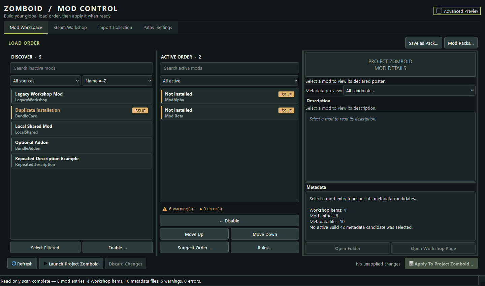
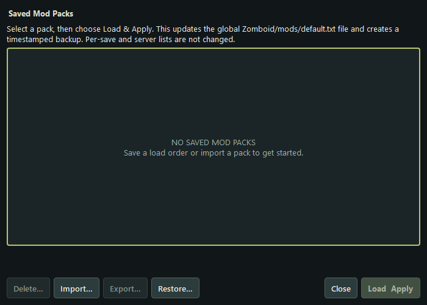

<div align="center">



**A mod workspace for Project Zomboid.**

</div>

ZomboidSorter discovers local and Steam Workshop mods, shows metadata and warnings, lets you stage a global load order, and saves reusable Mod Packs. It is an independent fan tool and is not affiliated with The Indie Stone.

**Development note:** AI tools assisted with portions of the code and documentation. Maintainers remain responsible for reviewing changes and validating releases. The screenshots below are captures of the running app with fixture data.

## Compatibility and evidence

| Platform | Status |
| --- | --- |
| Windows 11, 64-bit | Development and packaged launch checked on this machine. |
| Windows 10, 64-bit | Intended target; Windows 10 and other-PC installer tests remain unverified. |
| Project Zomboid Build 42 | Primary target. A local 42.21.0 installation was scanned read-only. |
| Project Zomboid Build 41 | Root `mod.info` metadata is recognized in fixtures; live B41 behavior is unverified. |

Discovery is read-only. It skips symbolic links and junctions and limits each `mod.info` read to 1 MiB; unreadable, oversized, or undecodable files are reported with their path. The app changes only the global `Zomboid/mods/default.txt` list after confirmation. It makes a timestamped backup, checks for concurrent edits, writes atomically, and reads the result back. Per-save and server configuration are unsupported. It never deletes installed mods or saves. A temporary global-list apply and restore was verified with the local Build 42.21.0 installation: the startup log showed the marker Mod ID, and the original list was restored byte-for-byte. The game reached its startup warning screen; no save was opened. Gameplay behavior and loading a save were not tested; testing on other PCs and Windows 10 remains unverified.

## Download and install

1. Open [Releases](https://github.com/LookImEcho-Rick/ZomboidSorter/releases) and download `ZomboidSorter-<version>-windows-setup.exe` from the latest release. The adjacent `.sha256` file contains its SHA-256 checksum.
2. Run the installer. It installs for the current Windows user and adds a Start menu shortcut. Windows may warn about an unsigned installer; inspect the checksum before proceeding.
3. Launch **ZomboidSorter** from Start. The PySide6/Qt runtime and embedded Workshop browser are included; Python is not required.

Use **Check for Updates** in the app header to check GitHub for a newer stable release. If one is available, the app asks before downloading, verifies the installer against the release SHA-256 file, and opens the normal Windows installer to finish the upgrade.

If there is no Release with a downloadable installer yet, use the source instructions below. Do not download an installer from an unofficial mirror.

## First launch and basic use

1. Install and launch Project Zomboid through Steam at least once. Open its Mods screen to let the game create the global list if `default.txt` is missing.
2. In **Paths Settings**, confirm the detected local mods folder, Workshop folder, and global `Zomboid/mods/default.txt` path. Use **Refresh** to scan; the scan is read-only and can be cancelled while it runs.
3. In **Mod Workspace**, select entries under **Discover** and enable them into **Active Order**. Drag or use the move buttons to stage an order. Warnings identify missing and duplicate IDs; an order suggestion is a proposal, not a guarantee of the game's runtime order.
   Under **Target metadata**, choose Build 41 or Build 42. For Build 42, enter the exact game version shown on the game's main menu (for example, `42.21.0`). The app selects the newest compatible version folder at or below that version; this chooses metadata for details, dependency checks, and order suggestions, but does not prove the mod's content is compatible.
4. Use **Save as Pack…** to keep the staged list as an app-owned Mod Pack. **Mod Packs…** can import, export, recover, and apply packs. Applying a pack updates the same global list with a backup.
5. Select **Apply To Project Zomboid…** to confirm a global-list write. **Apply & Launch…** applies staged changes first and asks Windows to hand the game link to Steam; successful handoff does not prove that the game started.

The Steam collection importer reads public Workshop data and saves a pack; it does not subscribe, download, or update mods. The optional overlap and console-log checks report evidence, not confirmed in-game conflicts.

## Screenshots

These screenshots use test fixtures and temporary profile data. The warning rows and mod names are examples, not a real-game test.





## Data, backups, and uninstall

- Mod Packs: `%APPDATA%\ProjectZomboidModManager\profiles\`. Replaced packs have copies in `backups\`; deleted packs move to `deleted\` for recovery.
- App settings, chosen paths, ordering rules, and window state: `HKEY_CURRENT_USER\Software\ZomboidSorter\ProjectZomboidModManager` via Qt settings.
- Game-list backups: alongside the selected global file as `Zomboid\mods\default.txt.bak-<timestamp>`.

An upgrade replaces application files in the same per-user install directory and keeps these data locations. Uninstall from **Windows Settings → Apps** or the Start menu shortcut. Uninstall leaves Mod Packs, settings, game-list backups, saves, and installed mods intact. Remove app-owned settings and packs manually only if you want to discard them.

## Troubleshooting

- **No mods found:** check Paths Settings, the Steam library, and whether Workshop content is installed. A Workshop item can contain several Mod IDs.
- **Cannot load or apply:** choose the global `Zomboid/mods/default.txt`. Unknown syntax, save-specific paths, symlink targets, and externally changed files are refused. Reload after another program edits it.
- **Workshop page or description unavailable:** check Steam/network access. Local metadata remains usable.
- **Launch did not start the game:** open it in Steam directly. The app can confirm only that Windows accepted the Steam link.
- **Problems after an apply:** close the game and restore the appropriate `default.txt.bak-<timestamp>` copy after reviewing it. Mod Pack backups are managed inside **Mod Packs…**.

## Run or build from source

Use Python 3.14+ on Windows:

```powershell
python -m venv .venv
.\.venv\Scripts\python.exe -m pip install -e ".[dev,windows]" -c packaging\constraints-windows.txt
.\.venv\Scripts\python.exe -m zomboid_mod_manager
```

Run checks and build the installer with Inno Setup 6 installed:

```powershell
$env:PYTHONPATH = (Join-Path (Get-Location) 'src')
.\.venv\Scripts\python.exe -m unittest discover -s tests -v
.\.venv\Scripts\ruff.exe check src tests
.\.venv\Scripts\ruff.exe format --check src tests
.\packaging\build_installer.ps1
```

See [packaging/README.md](packaging/README.md) for the build, license review, and release process; [docs/PROGRESS.md](docs/PROGRESS.md) for validation evidence and limits. The original code is licensed under [GPL-3.0-or-later](LICENSE). The installer bundles third-party components with separate terms.
